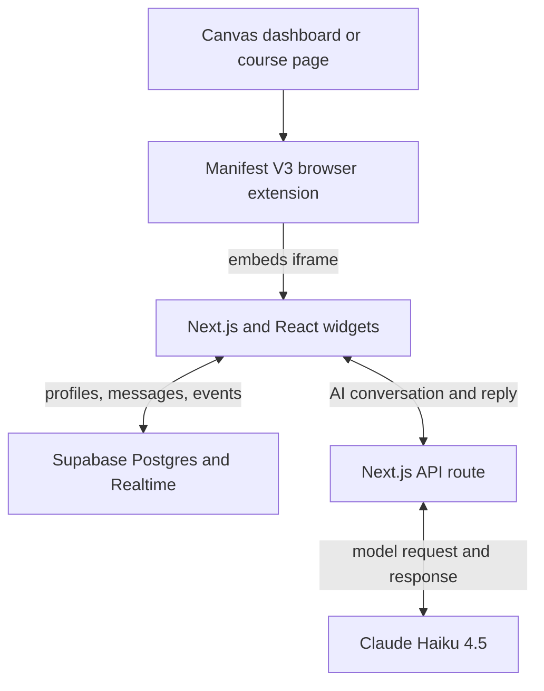

# BridgeUp Web App

BridgeUp is a hackathon prototype designed to help first-generation students at Arizona State University connect with a peer and find campus support inside Canvas. This directory contains its Next.js web app. Cleanup and refinement are still needed before the project is complete.

## Project summary (STAR)

**Situation:** Students who are unfamiliar with college systems or hesitant to seek help can struggle to find a relevant campus resource. BridgeUp focuses on first-generation ASU students and brings support into their learning environment.

**Task:** As the sole software developer and engineer on the team, I needed to translate the product concept into a connected prototype with peer accountability and actionable resource guidance.

**Action:** I implemented the Canvas browser extension, Next.js widget interfaces, Supabase persistence and live updates, and a server-side Claude API integration. The web app combines profile creation, peer check-ins, chat, AI Help, a semester roadmap, and course support.

**Result:** The implementation spans three widget views and a dashboard with four areas: Check-in, Chat, AI Help, and Plan. It demonstrates the connected product experience; its intended effect on student help-seeking still needs user validation.

## Team and my contribution

This was a team project that included product management, student experts, and general participants. I was the sole software developer and engineer and handled the software implementation across the extension, frontend, data integration, Realtime subscriptions, and AI API route.

## Product experience

| Area | Student need | Implemented response |
| --- | --- | --- |
| Onboarding | A personal starting point for support | A five-step flow captures goals, course concerns, an avatar, comfort asking for help, first-generation status, and a check-in preference. |
| Check-in and Chat | Peer encouragement and accountability | Stored messages and dashboard events connect students in a shared demo room through live updates. |
| AI Help | One concrete resource and next step | Claude is prompted to recommend a relevant ASU resource; initial question suggestions vary by the first-generation profile flag. |
| Plan and course support | Earlier awareness of useful services | A roadmap, resource checklist, and calendar-based nudges introduce academic and campus support. |

## Tools and their roles

| Tool | What it is used for |
| --- | --- |
| Next.js 16 / App Router | Widget routes, embedding configuration, and the server-side AI endpoint. |
| React 19 | Components and state for onboarding, dashboard tabs, chat, resource cards, and roadmap interactions. |
| TypeScript 5 | Record types and component props, with strict checking enabled; the Supabase proxy still uses an `any` escape hatch. |
| Tailwind CSS 4 | Compact widget layouts, the maroon-and-gold interface, and visual interaction states. |
| Supabase Postgres and JavaScript SDK | Storage and queries for student profiles, chat messages, and dashboard events. |
| Supabase Realtime | Subscriptions to room-filtered message and event inserts. |
| Anthropic SDK / Claude Haiku 4.5 | Server-side model calls with a curated ASU resource list and response instructions. |
| react-markdown | Formatting assistant replies and rendering clickable resource links. |
| Browser local storage | Remembering the profile ID and onboarding flag between visits. |
| Manifest V3, JavaScript, and CSS | The sibling browser extension that embeds these widgets and manages the Canvas panel. |
| ESLint 9 and npm | Configured lint rules, dependency management, lockfile, and app scripts. |

## System architecture

## Data and request flow

- **Profile:** Onboarding writes a `students` record. The browser remembers its ID, and the dashboard loads the profile and the most recent other student in the shared `demo` room.
- **Messages and events:** Chat loads message history and subscribes to inserts. Check-ins, struggling signals, and simulated booking actions write `room_events`, which drive incoming dashboard alerts. React effects clean up subscriptions on unmount.
- **AI:** The client sends its conversation to `POST /api/ai-help`. That route calls `claude-haiku-4-5-20251001` with a 300-token output limit and resource instructions, keeping the Anthropic key off the client. The UI renders the reply as Markdown and displays a fallback on connection failure.

## Implementation map

| Source | Responsibility |
| --- | --- |
| `app/widget/onboarding/page.tsx` | Student profile creation and partner introduction |
| `app/widget/dashboard/page.tsx` | Check-ins, live chat, AI Help, and semester roadmap |
| `app/widget/course/page.tsx` | Course support and calendar-based nudges |
| `app/api/ai-help/route.ts` | Server-side Claude integration and ASU resource guidance |
| `lib/supabase.ts` | Database client, shared demo room, and record types |
| `next.config.ts` | Widget embedding headers |

## Engineering tradeoffs and project status

The extension embeds a separate web application, keeping Canvas page handling apart from the student interface. Supabase supplies persistence and live updates without a custom messaging server. A server-side AI route keeps the model key off the browser and centralizes the resource instructions.

The prototype uses browser-local identity and a shared demo room. Matching is not based on verified course enrollment, and there is no Canvas API integration. Streaks, milestones, and usage counts include illustrative values, booking actions are simulated, and some interaction state resets on reload. Calendar logic uses Spring 2026 dates and a week-1 override for the Plan tab.

Further work includes authenticated identities and pair access, database typing and error handling, component cleanup, shared semester configuration, automated flow tests, and evaluation of resource recommendations with students. AI input/output validation and rate limiting also remain to be implemented.

This README presents the prototype as an engineering and product showcase. The implementation remains a work in progress.
